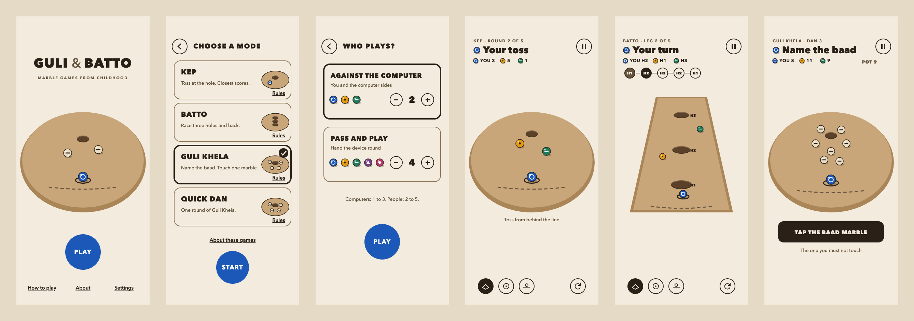
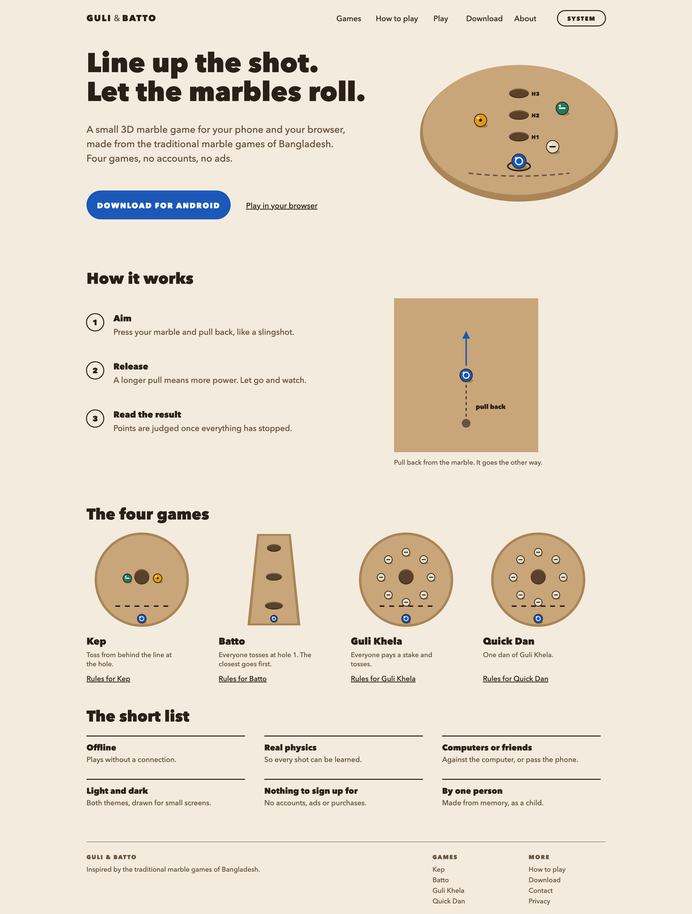

# Guli & Batto

**Marble games from childhood, as a 3D game.** Four traditional games from Bangladesh, each played on bare ground with a line, a hole and a few marbles, rebuilt with real physics so every shot can be learned. Free, offline, no accounts, no ads. One game on Android and in the browser.

[](https://github.com/shahadathhs/GuliBatto/actions/workflows/ci.yml) [](https://github.com/shahadathhs/GuliBatto/releases)

## Live

|          |                                                                                                                       |
| -------- | --------------------------------------------------------------------------------------------------------------------- |
| Website  | https://playgulibatto.vercel.app                                                                                      |
| Play     | https://playgulibatto.vercel.app/play (the full game, in your browser; about 40 MB the first time)                    |
| Download | https://playgulibatto.vercel.app/download, and the [releases page](https://github.com/shahadathhs/GuliBatto/releases) |



_Drawn renders of the app's screens, in light and dark, regenerated from the design tokens with `node scripts/design/render.mjs`. All four games are built; the "Who plays?" screen and the five-side Kep screen are built too. Every screen is listed in [docs/design/SCREENS.md](docs/design/SCREENS.md)._

## The idea

A patch of bare ground, a line scratched with a stick, a small hole, a handful of marbles. The rules lived in people's heads and changed a little from street to street. This game is one person's attempt to bring those afternoons back: line up a shot, judge distance and angle, release, watch the marbles collide and roll, and understand why the turn went the way it did.

Nothing here is invented from nothing. Each game starts from one people played, the author changed some rules to suit a screen, and one page says exactly where the rules come from and what changed ([About these games](docs/README_ABOUT.md)). It does not claim to be the official rules, and if you remember the game differently, you are not wrong.

## The games

Play against one to three computer sides, or pass and play: two to five people share one device, with a hand-over screen before each turn ([docs/README_PLAY_MODES.md](docs/README_PLAY_MODES.md)). The rules in plain words are in [docs/README_GAME_RULES.md](docs/README_GAME_RULES.md).

| Game           | The idea                                                                                                                                                                   | State    |
| -------------- | -------------------------------------------------------------------------------------------------------------------------------------------------------------------------- | -------- |
| **Kep**        | Toss a marble from behind the line at a hole. A marble in the hole scores 3, then the closest scores 2, then the next closest 1. Five rounds.                              | Playable |
| **Batto**      | Race along three holes and back. Hit a rival's marble, or reach a hole, to take another shot. The last to finish loses.                                                    | Playable |
| **Guli Khela** | Stake marbles are scattered round the hole. Name the marble you must not touch, then touch exactly one other. A wrong touch costs a fine, and the winner takes the ground. | Playable |
| **Quick Dan**  | One round of Guli Khela, for when you have a few minutes.                                                                                                                  | Playable |

## How it plays

Press your marble and drag back, like a slingshot. The arrow shows the direction and a longer pull means more power. Release to shoot. Everything then rolls under real physics until it stops, the result is judged once from where the marbles rest, and a short note says what happened and why.

- **Real physics.** Friction, rolling and collisions decide every shot. There are no scripted outcomes, and a marble that is too fast rolls straight over the hole.
- **The camera never changes your shot.** Drag empty ground to turn the view, scroll or pinch to zoom, and pick one of three views. The aim is worked out on the ground, not on the screen.
- **Clear results.** Each side has its own colour and mark (ring, dot, bar, triangle), so colour is never the only signal.
- **Light and dark themes,** both first-class.

## Get it

Every release publishes the APK, the web export and a checksum file.

| Platform | File                      | Note                                                  |
| -------- | ------------------------- | ----------------------------------------------------- |
| Android  | `gulibatto-<version>.apk` | Allow installs from your browser once; not on a store |
| Web      | played at `/play`         | No install                                            |



_The website's home page, drawn from the same tokens and marble marks as the site (light and dark in `docs/design/web/`, with a game page and the download page). Drawn, not captured: a headless browser does not keep the layout of the real site, so the live site at the address above is the reference._

## Why it is built the way it is

- **One game, two ways to play.** One Godot project exports to Android and to the browser. The web version is the full game, not a try-out, and the site and the app carry the same information from one source.
- **Offline and private.** No accounts, no tracking, no ads, no third-party scripts on the website. The browser version runs entirely in your browser.
- **Honest about tradition, in one place.** No game carries an "authentic" or "adapted" label; the About page names the sources and lists what was changed.
- **Rules are tested, not hoped for.** Every rule has a test on a hand-built board, scoring is decided once from where the marbles rest, and real input is driven through the whole game in the tests.

## How it fits together

```text
   design/tokens.json     one source of colours: generates the game's palette and the site's CSS

   ┌──────────────────────┐   make / CI    ┌────────────────────────┐
   │ Game (Godot 4, Jolt) │───────────────▶│ Godot Docker image     │
   │ one project          │  export x2     │ Android APK and the    │
   │ game/                │                │ web export             │
   └──────────────────────┘                └───────────┬────────────┘
                                                       │ version change on main
                                                       ▼
   ┌──────────────────────┐  fetch at build  ┌─────────────────────────┐
   │ Website (Next.js)    │◀─────────────────│ GitHub Releases         │
   │ Vercel, web/         │  rebuild hook    │ files + SHA256SUMS      │
   │ pages + /play        │◀─── (on release) │ rolling latest + vX.Y.Z │
   └──────────────────────┘                  └─────────────────────────┘
```

**Physics first.** Marbles are real rigid bodies. The ground is plain boxes with a small dish at each hole; a slow marble drops in, a fast one skips over. All of it is sampled from one function, so what you see is what rolls.

**One shot path.** The player and the computer sides both build the same shot command. Only the physics layer applies a push, and the rules read a snapshot of where everything came to rest.

## Tech stack

| Part     | Technology                                                                              |
| -------- | --------------------------------------------------------------------------------------- |
| Game     | Godot 4.7, GDScript, Jolt physics, GUT tests, gdtoolkit (gdlint, gdformat)              |
| Web      | Next.js 16, React 19, TypeScript, oxlint, Node's test runner                            |
| Pipeline | GitHub Actions, the `barichello/godot-ci` image through Docker Compose, GitHub Releases |
| Hosting  | Vercel (the site), GitHub Releases (the files)                                          |
| Tooling  | pnpm, Husky, commitlint (Conventional Commits), Prettier, Dependabot                    |

## Repository layout

```text
game/       the Godot project: scripts, scenes, data and tests
web/        the website (Next.js)
design/     tokens.json, the one source of colours
docker/     the Godot image for checks and exports
scripts/    token generation, checks, version bump, concept renders
docs/       the specification, the plan and the design images
Makefile    the command surface (CI runs the same targets)
VERSION     the source of truth for releases
```

## Run it

```sh
make setup           # once: hooks, lint tooling, Godot cache
make run             # play on this machine (needs Godot 4.7)
make check           # every gate CI runs: lint, tokens, colours, tests, site build and smoke test
make web-dev         # the website at localhost:3000
make game-apk         # the Android build, in the Godot container
make help            # every target
```

Work on `dev` and open a pull request into `main`. A version change (`make release v=X.Y.Z`) builds the APK and the web export and publishes a release.

## Documentation

| Start here                                                           |                                                                           |
| -------------------------------------------------------------------- | ------------------------------------------------------------------------- |
| [docs/README_PROJECT_OVERVIEW.md](docs/README_PROJECT_OVERVIEW.md)   | The product document: vision, the games, scope, what "done" means, status |
| [docs/README_ABOUT.md](docs/README_ABOUT.md)                         | Where the rules come from and what the author changed                     |
| [docs/README_GAME_RULES.md](docs/README_GAME_RULES.md)               | The four games in full                                                    |
| [docs/README_ROADMAP.md](docs/README_ROADMAP.md), [TODO.md](TODO.md) | The order of work and the checklist                                       |
| [docs/README_ARCHITECTURE.md](docs/README_ARCHITECTURE.md)           | How the game is built                                                     |
| [docs/README_PLAY_MODES.md](docs/README_PLAY_MODES.md)               | Against the computer, and pass and play with two to five people           |
| [docs/README_WEB_AND_APP_PLAN.md](docs/README_WEB_AND_APP_PLAN.md)   | The pages on the web and in the app                                       |
| [docs/CI.md](docs/CI.md), [docs/DEPLOY.md](docs/DEPLOY.md)           | The pipeline, releases and the Vercel setup                               |
| [docs/README_VISUAL_DESIGN.md](docs/README_VISUAL_DESIGN.md)         | The visual language and the screens                                       |
