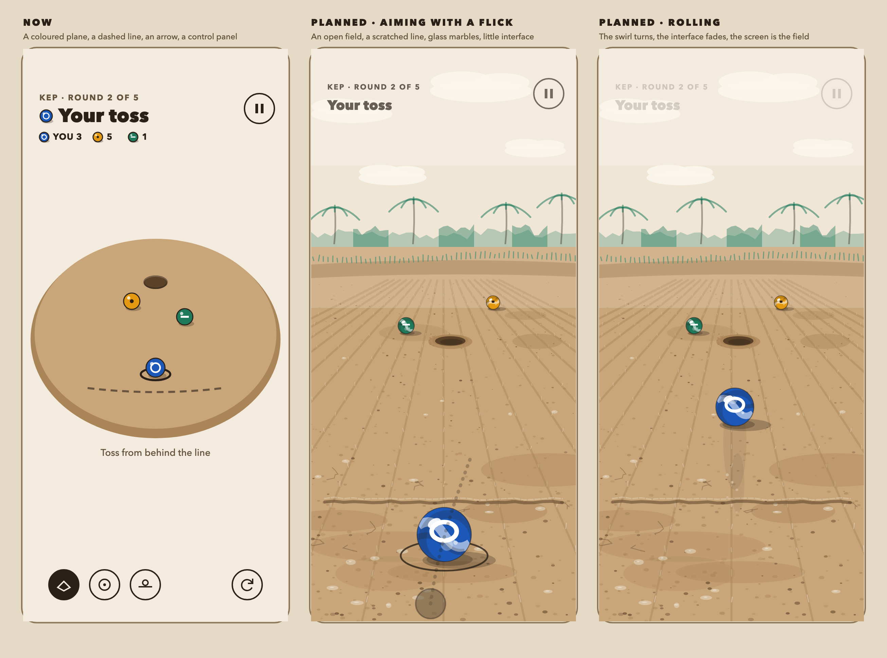

# Guli & Batto — Feel: marbles on the ground, not a digital board

> **Purpose:** the game works, but it feels like moving physics objects around a board. This plan says why, and what changes so it feels like crouching over bare ground with a handful of marbles.  
> **Written 2026-10-22,** after the author played it and agreed with the diagnosis. **Steps A and B are built (first pass, same day):** the swirled marble, its shadow, the dirt ground, the open field, the scratched jalla and the worn holes, checked in the real renderer in both themes. Also built the same day: a **real 3D view**, a low default camera, a low sun with shadows, and palms, bamboo, bunds and grass as real meshes (see the architecture doc), replacing the flat painted backdrop as the main view. Not yet built: the rolling sound, the faded interface, the flick, and tuning by play. Unmeasured: speed on a phone and in a browser with shadows and the extra meshes.

## 1. Why it feels like a digital board

From the code, not from guesswork:

| What the game does now                                                                             | What it does to the feel                                                            |
| -------------------------------------------------------------------------------------------------- | ----------------------------------------------------------------------------------- |
| The marble is a plain coloured sphere (`Marble.setup`), with a flat mark on top that does not spin | A rolling marble looks like a sliding disc; nothing shows that it is turning        |
| The ground is flat boxes in one earth colour with a rim (`Arena`); the line is a dashed stroke     | A tidy arena, not bare dirt with a line drawn by a stick                            |
| You pull back and an arrow and a power bar tell you the shot                                       | A control panel does the judging; a real shot is one flick, judged by eye and thumb |
| Chips, a turn label, banners and "Rolling" and "Waiting" text sit over the scene                   | The interface is between you and the ground                                         |
| One click sound for every contact, no rolling sound, no difference between marble, dirt and hole   | Contact has no material; a rolling marble is silent                                 |
| The camera is a fixed angled view of a board                                                       | You look at a game board, not at a marble from where you are crouching              |
| Every number (damping, shot speed, settle time) came from measurement and tests, never from play   | Nobody has checked that the roll _feels_ right                                      |

The physics itself is real and stays: rolling, friction, collisions, the dish in the hole. The work is in what you see, hear and do around it.

_A drawn concept of the open-field setting (light; [dark](design/feel-planned-dark.png)), made by `scripts/design/feel.mjs` from the colour tokens. It shows the intent, not the 3D game: the real ground, light and marble will differ._

## 2. What changes, in order

### A. The marble (look): it must visibly roll

- A marble texture with a swirl (bands of the side's colour and a lighter core), made by a small script from the colour tokens so it is generated, not drawn by hand, and a glassy highlight. The Compatibility renderer has no refraction, so the glass look comes from the swirl, a sharp highlight and a little rim light, not from transparency.
- The swirl is on the sphere and turns with it, so you see it roll. The mark stays a flat badge on top (colour and mark remain the rule), so a side is still readable.
- A soft contact shadow under each marble so it sits on the ground, not above it.

### B. The ground and the field: bare dirt in an open field, not a coloured plane

- A small tiling ground texture from the `earth` tokens: grain, a few pebbles and scratches, darker where hands would have worn it round the hole; no new colours outside the token file (shades of `earth`, `earth-rim` and `hole`).
- The jalla becomes a scratched line with an uneven edge, not a dashed stroke; the hole gets a worn, crumbly rim.
- **The setting is an open field**, seen from a low camera: a wide sky, a far hazy line of palms and bamboo, a low earth bund with a fringe of grass, and stubble rows running to the horizon, so the ground has depth and a real place to be in. This reverses the earlier "no village backdrop" caution only as far as the open field: no buildings, people, animals, boats, flags, patterns or writing, and never as a claim of authenticity (About and the visual design say the same).
- No other decoration for its own sake: nothing that reads as a folk motif.
- In 3D this is a sky colour, a distant strip of flat tree silhouettes on a billboard or the far wall, a bund as a low mound in the ground mesh, and a tiling ground texture with stubble rows; it must stay light enough for the browser build.

### C. The shot: one flick

- A **flick** gesture next to today's pull: touch near the marble and swipe through it; the swipe's direction and speed are the shot. No arrow, no power bar; at most a faint trace of the swipe.
- Settings gets **Shot: Pull / Flick**; the first-use prompt teaches whichever is on. The pull stays for precision and for the mouse in a browser.
- This is the one choice that needs the author: make Flick the default (more like the real thing, harder to aim) or keep Pull as the default (easier, less true). Recommendation: Flick as the default on a phone, Pull in a browser.

### D. Less interface while it rolls

- The HUD chips, turn label and hint fade to a hairline while marbles move and return when they stop; results appear as a short line by the marbles, not a banner.
- A lower, closer default view (a crouching eye line), the shot-follow camera on for every mode, and the top-down view as a choice, not the default.

### E. Sound and touch

- A **rolling sound** that follows the marble's speed (a soft grain on dirt that fades as it slows), clicks that differ by what is struck (glass on glass, glass on dirt, glass into the hole), and a short vibration on a hit on Android.
- All synthesized by `scripts/sounds.mjs` like the rest; no recordings.

### F. Tuning by play, with numbers to aim at

- Write down targets and check them: a full-power shot rolls about the distance the board suggests; a marble is still after 3 to 5 seconds; a toss at the kep captures about one time in three.
- Then change the numbers while playing, not from tests alone. The tests keep them from drifting afterwards.

## 3. Order and cost

| Step | What                                        | Cost   | Risk                                                                |
| ---- | ------------------------------------------- | ------ | ------------------------------------------------------------------- |
| 1    | A and B together: the marble and the ground | Small  | Web size and speed (textures stay small and tiling); tokens only    |
| 2    | E: rolling and contact sound, vibration     | Small  | Taste: needs to be heard; the first version is a guess              |
| 3    | D: fade the interface, lower default camera | Small  | Players still need the turn and the standings to be findable        |
| 4    | C: the flick                                | Medium | Aim accuracy on small screens; needs hand tuning with the pull kept |
| 5    | F: play and tune                            | Time   | Only the author's hands can judge it                                |

Steps 1 to 3 change the look and sound without touching the rules or the shot path (one shot path, real physics, rules read snapshots). Step 4 adds a second way to build a `ShotCommand`; it never changes the physics.

### Exit criteria

- A person watching a shot can tell the marble is turning.
- A screenshot reads as dirt in an open field with a line scratched in it, in both themes, with no buildings, people or patterns.
- A flick shoots with no arrow and no bar, and Pull still works.
- While marbles move, the screen is almost all ground.
- Someone who played marbles as a child says it looks and sounds right, or says what is wrong.

## 4. Not changing

- The rules, the four games, the physics, the shot path, the rule that colour is never the only signal.
- Realism for its own sake: no 3D scanned textures, no photographic ground, nothing that costs web performance.
